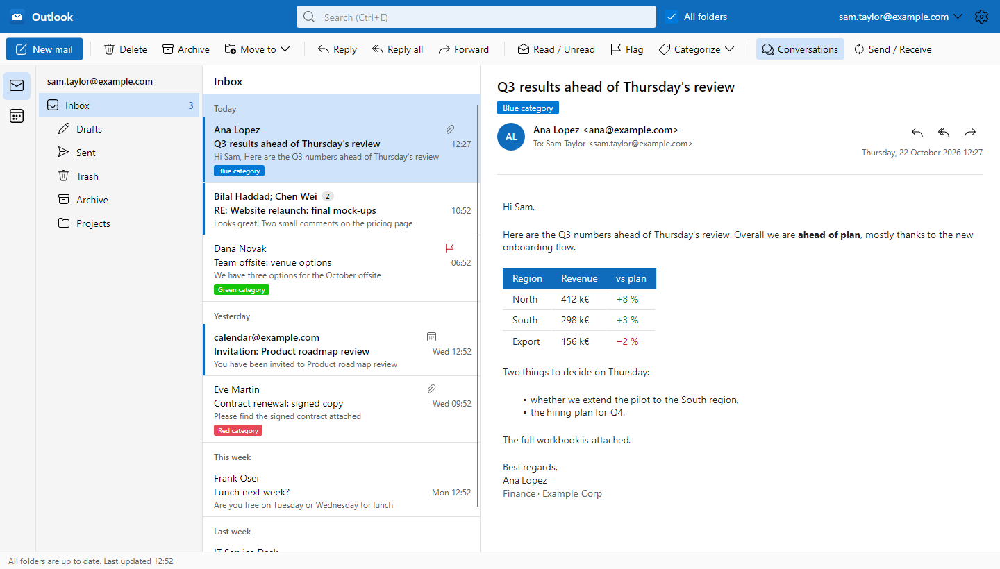
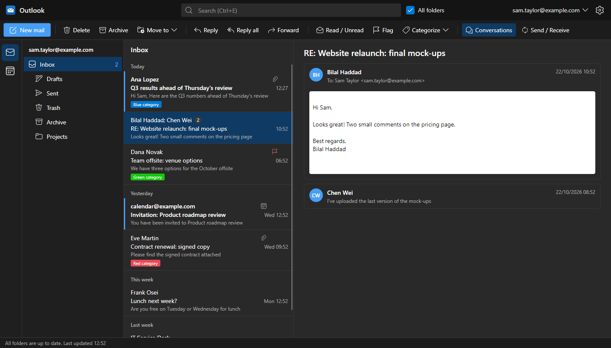
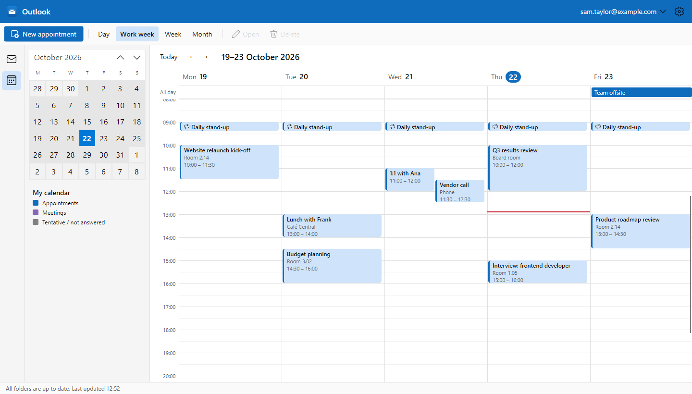
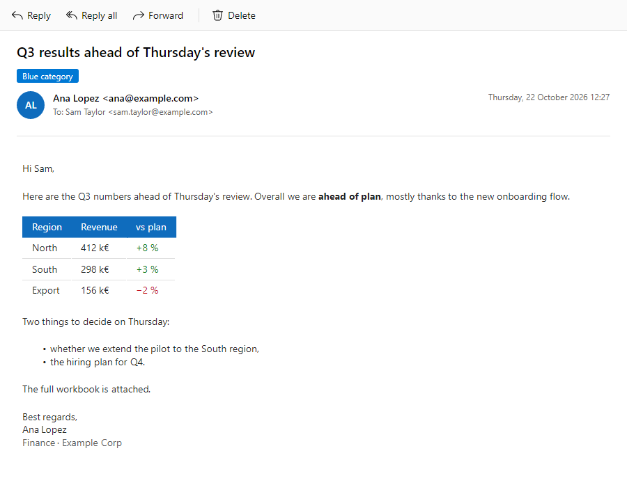
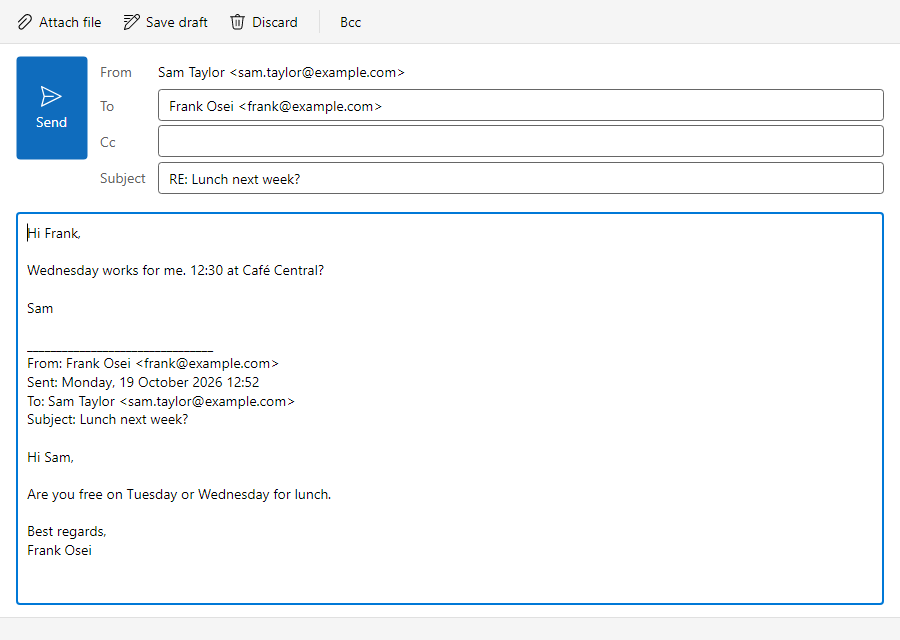

# Outlook Clone

[](https://github.com/pentest30/outlook-clone/actions/workflows/build.yml)

A classic desktop mail and calendar client in the spirit of Outlook, built with **Avalonia** and **.NET 10**.
It talks to real mail servers over **IMAP/SMTP**, keeps a local SQLite cache (like Outlook's `.ost` file) so it
stays fast and works offline, and ships as a per-user Windows installer.



## Features

**Mail**
- Three panes: folders, message list grouped by date, reading pane with HTML mail (scripts never run,
  remote pictures blocked until you click *Download pictures*, inline pictures shown)
- Conversations: one row per thread, the whole thread stacked in the reading pane, your replies from Sent included
- Compose, reply, reply all, forward, drafts saved automatically, attachments (drag and drop), signatures,
  address autocomplete, **undo send**
- Search (Ctrl+E) with operators: `from:` `to:` `subject:` `category:` `has:attachment` `is:unread` `is:flagged`
- Categories (stored on the server as IMAP keywords, so they follow the mail), flags, read/unread
- Move, archive, delete, drag messages onto folders, multi-select, context menus
- Open a message in its own window (double-click or Enter)
- Push for new mail (IMAP IDLE), desktop alerts, unread count on the tray icon

**Calendar**
- Day, work week, week and month views; drag to move or resize appointments
- Repeating appointments, reminders, all-day events
- Meetings by e-mail (iCalendar / iMIP): send invitations, and accept, tentatively accept or decline the ones you get.
  Works with any mail server.

**Everyday use**
- Several accounts; server settings found automatically from the e-mail address (Mozilla ISPDB, then MX lookup)
- Passwords encrypted with Windows DPAPI, per user
- Light and dark themes, Outlook keyboard shortcuts
- Keeps running in the notification area when the window is closed (optional)
- Windows installer (Velopack): no admin rights, Start menu and desktop shortcuts, uninstaller

| Dark theme, conversation view | Calendar |
|---|---|
|  |  |

| Message window | Compose |
|---|---|
|  |  |

## Install

Download `OutlookClone.Desktop-win-Setup.exe` from the [releases](https://github.com/pentest30/outlook-clone/releases)
(or the installer artifact of a [build](https://github.com/pentest30/outlook-clone/actions)) and run it.
On first start, enter your e-mail address and password; the IMAP and SMTP servers are detected for you.

Mail data lives in `%LOCALAPPDATA%\OutlookClone` and is kept when the app is uninstalled.

> Microsoft 365, Outlook.com and Gmail no longer accept plain-password IMAP; they need OAuth2, which is not
> supported yet. Most other providers (OVH, IONOS, Fastmail, company servers…) work.

## Build from source

Requires the [.NET 10 SDK](https://dotnet.microsoft.com/download).

```powershell
dotnet run --project src/Outlook.App          # run the app
dotnet test                                   # unit and headless UI tests
pwsh build/package.ps1                        # Windows installer in releases/
```

### Development mail server

[GreenMail](https://greenmail-mail-test.github.io/greenmail/) in Docker accepts any login, so you can try
everything without a real mailbox:

```powershell
docker compose up -d                          # IMAP on 3143, SMTP on 3025
dotnet run --project tools/Outlook.DevSeed    # put sample mail in dev@localhost
$env:GREENMAIL = 1; dotnet test               # include the IMAP/SMTP sync tests
```

Sign in with `dev@localhost`, any password, IMAP `localhost:3143`, SMTP `localhost:3025`, no TLS.
Set `OUTLOOKCLONE_DATA` to a folder to keep a test profile apart from your real one.

### Screenshots

The pictures above come from the headless UI tests, with made-up data. To refresh them:

```powershell
$env:README_SHOTS = "$PWD/docs/screenshots"
dotnet test tests/Outlook.App.Tests --filter MainWindowShots
```

## Project layout

```
src/
  Outlook.Core       models and interfaces, HTML clean-up, search query parsing (no UI, no I/O)
  Outlook.Data       EF Core SQLite cache with full-text search, DPAPI credential store
  Outlook.Mail       MailKit IMAP sync engine and SMTP sender, server discovery
  Outlook.Calendar   local iCalendar store, recurrence, meeting invitations
  Outlook.App        Avalonia desktop app (views, view models)
tests/
  Outlook.Tests      unit and GreenMail integration tests
  Outlook.App.Tests  headless UI tests (Avalonia.Headless + Skia)
tools/               sample mail seeder, icon generators
build/               installer script
```

Built with Avalonia, CommunityToolkit.Mvvm, MailKit/MimeKit, EF Core (SQLite), Ical.Net,
Avalonia.HtmlRenderer and Velopack. Icons are [Fluent UI System Icons](https://github.com/microsoft/fluentui-system-icons) (MIT).

The roadmap is in [docs/PLAN.md](docs/PLAN.md).
